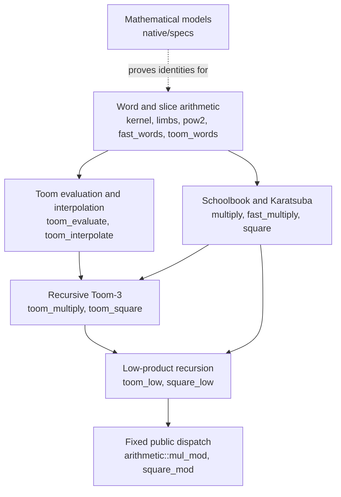

# VeriGMP

[简体中文](README.zh-CN.md)

VeriGMP is a Rust library for multiprecision multiplication, squaring and modular
slice arithmetic whose
executable functions are proved correct with [Verus](https://github.com/verus-lang/verus).
It adopts algorithm and storage strategies from GMP (the GNU Multiple Precision
Arithmetic Library), writes the implementation and proofs independently, and
measures the result against GMP and against its own earlier code.

The library is experimental and deliberately narrow. It does not verify GMP, does
not offer a GMP-compatible API and does not claim performance parity with GMP.

The registered performance target is a median time no greater than GMP on the
principal workloads, with no registered key shape above 1.2 times GMP. The target
requires matching result semantics, the same compiler toolchain and linked builds,
and a confirming run; it has not been reached.
See [the measurement contract](native/performance-target.json) and
[its evaluation procedure](docs/benchmarks.md#performance-target).

Individual optimizations can enter main before the overall GMP target is met.
Each needs reproducible gains over the current implementation on its declared
workloads, relevant regression and combination measurements, same-source proof
and correctness checks, and independent Astra Max review. CI is supplemental
evidence and does not block development or merge. Formal obligations may run in
fixed-source batches with pending status disclosed. Shape-dependent gains justify
scoped dispatch. Replacing a consuming solver's trusted GMP backend
requires all registered performance gates, a second independent confirmation,
semantic compatibility and representative solver traces. Retained experiment
archives preserve evidence without enabling their candidates in production.

## What it computes

A number is a slice of limbs: little-endian 64-bit words. With `B = 2^64`, the
slice `a` means `value(a) = sum(a[i] * B^i)`. A precision is described by the
limb count `n` and the number of significant bits `top` (1 to 64) in the highest
limb, so the bit precision is `p = 64*(n-1) + top`.

The public entry points live in `arithmetic`:

| Function | Result written to `dst` (`n` limbs) | Scratch words |
|---|---|---|
| `mul_mod(dst, a, b, scratch, top)` | `value(a) * value(b) mod 2^p`, canonical | `workspace_len(n)` = `12n` |
| `square_mod(dst, a, scratch, top)` | `value(a)^2 mod 2^p`, canonical | `square_workspace_len(n)` = `10n` |

Each function has a Verus contract stating exactly that result, and the Rust body
is proved to satisfy it. The caller owns the output and the reusable scratch
workspace; the arithmetic does not allocate. Inputs may hold bits above the
precision, and the initial contents of `dst` and `scratch` do not matter.

Behind those two functions are schoolbook multiplication, difference-form
Karatsuba, five-point Toom-3, dedicated recursive squaring and truncated
low-product recursion. Products below 512 limbs take the original Karatsuba
path and larger products take the Toom-3 path. Squares always take the dedicated
low-square recursion. Up to 64 limbs it uses a leaf kernel described below;
above that it squares a low block of `n - floor(11n/36)` limbs in full, with
Toom-3 when that block exceeds 192 limbs and Karatsuba squaring otherwise.
Full-square leaves of at least eight limbs use a proved triangular symmetric kernel.
Low-square leaves from 9 to 64 limbs use a proved triangular symmetric kernel for
the truncated low-product case, computing only the lower `n` limbs by retaining
its cross products and diagonals below the output radix. Below 9 limbs the
low-square entry retains generic multiplication. These thresholds are a fixed,
measured policy, not a claim of optimality.

## Quick start

The pinned bootstrap supports x86_64 Linux, including WSL. Install Python 3.12 or
newer, `g++`, `libgmp-dev` and rustup, then run:

```sh
git clone https://github.com/miles-song/VeriGMP.git
cd VeriGMP
rustup toolchain install 1.99.1 --profile minimal
python3 scripts/setup_verus.py
python3 scripts/verify.py
```

`setup_verus.py` downloads the Verus release pinned in
[native/toolchain.json](native/toolchain.json), checks its SHA-256 hash and unpacks
it under `deps/`. `verify.py` proves and compiles the library, runs the integer
oracles, mutation checks, code inspection and benchmarks, and exports the compiled
library `build/libverigmp.rlib` together with its Verus metadata
`build/verigmp.vir`. It ends by printing `"status": "pass"`.

With that export in place, build and run the example:

```sh
VERUS_BIN="$PWD/deps/verus/verus-x86-linux/verus"
"$VERUS_BIN" examples/modular_arithmetic.rs \
  --import verigmp=build/verigmp.vir \
  --extern verigmp=build/libverigmp.rlib \
  --compile -O -o build/modular-example
./build/modular-example
```

The core of [examples/modular_arithmetic.rs](examples/modular_arithmetic.rs):

```rust
let n = a.len();
let mut scratch = vec![0u64; arithmetic::workspace_len(n).expect("n > 0")];
let mut out = vec![0u64; n];
arithmetic::mul_mod(&mut out, &a, &b, &mut scratch, top);
```

For `a = [3, 1]` and `b = [5, 2]`, the product is `[15, 11]` modulo `2^128` and
`[15, 1]` modulo `2^65`. Native Windows and other targets have not been validated
with this bootstrap.

## How the pieces fit



Models define what the words mean and prove the algebra, such as the five-point
Toom identities, without reference to any executable output. Each layer above
proves that its Rust code meets a contract stated in those terms, and the next
layer relies only on that contract. [docs/architecture.md](docs/architecture.md)
walks through the layers with a worked example.

## Status and limits

The [frozen low-square candidate](docs/data/2026-11-02-low-square-cutoff9/metadata.json)
reports 234 library verification items and no errors. Its 11,292 independent
integer oracle cases include 1,440 direct low-square cases and cover inputs up
to 4,097 limbs. The current Toom/square acceptance gate checks those cases,
12 invalid-input controls and 21 semantic mutations. A complete-library proof
claim requires the complete fixed-source `verify.py` gate; an isolated candidate
report does not establish that claim. Local feature gates and independent review
govern incremental merge acceptance; CI is supplemental. Verification items are not counts of
public functions. Detailed scope and historical results are in
[docs/verification.md](docs/verification.md).

The proof covers functional refinement: given the stated preconditions, the
output has the stated integer value. Termination and scratch capacity are also
checked. For fixed thresholds, the Toom recurrence gives an analytic bound of
`O(n^log3(5))`, about `O(n^1.465)`, word operations; that bound is derived by hand
and is not a machine-checked cost theorem. Measurements are reported separately
in [docs/benchmarks.md](docs/benchmarks.md). In two runs comparing the low-square
candidate with commit `c083839` on one machine, the 23-limb square takes 33–36%
less time and the 64-limb square takes 45–47% less time. The sampled dense sizes
from 9 to 64 limbs improve in both runs. This does not establish GMP parity:
at 4,096 limbs, products still take 2.330 and 2.359 times GMP, and squares take
2.173 and 2.141 times GMP. All measured shapes, including regressions, remain
in the linked dataset.

Not yet implemented: architecture-specific assembly, higher Toom variants and FFT,
composed cost model, and general division, inversion or higher-level integer APIs.
The exact claimed scope is recorded in [native/proof-status.json](native/proof-status.json).

The [Toom-8 dyadic recovery archive](experiments/toom8-primitives/dyadic-recovery/)
retains fresh verification of experimental dyadic and interpolation candidates:
478 and 514 items per entry (library, runner build and codegen build), with
fifteen coefficient outputs. This slice awaits independent acceptance and leaves
production dispatch unchanged; it does not establish a complete recursive
Toom-8 implementation.

## Documentation

- [docs/usage.md](docs/usage.md): installation, API contracts, scratch sizing and
  using VeriGMP from another project.
- [docs/architecture.md](docs/architecture.md): representation, module layers and
  the algorithms.
- [docs/verification.md](docs/verification.md): what is proved, what is tested and
  what is trusted.
- [docs/benchmarks.md](docs/benchmarks.md): measurement method and published data.
- [CONTRIBUTING.md](CONTRIBUTING.md): how to change a module without weakening its
  evidence.

## Further reading

- [Verus](https://github.com/verus-lang/verus) and its
  [installation guide](https://github.com/verus-lang/verus/blob/main/INSTALL.md):
  the verifier used here.
- [s2n-bignum](https://github.com/awslabs/s2n-bignum) and its
  [SOUNDNESS.md](https://github.com/awslabs/s2n-bignum/blob/main/SOUNDNESS.md): a
  separate verified bignum project whose soundness document separates proof
  target, assumptions and model boundaries. Its guarantees do not apply here.
- [mathlib4](https://github.com/leanprover-community/mathlib4): an example of
  documentation that separates using a library, exploring it and contributing.
- [GMP manual](https://gmplib.org/manual/), including its descriptions of the
  multiplication algorithms that informed this implementation.

## License and provenance

VeriGMP is released under the [MIT license](LICENSE). The GMP 6.3.0 source files
that informed the algorithms are pinned by hash in
[native/gmp-reference.json](native/gmp-reference.json). GMP is not linked into the
verified library; only the benchmark harness calls it.
