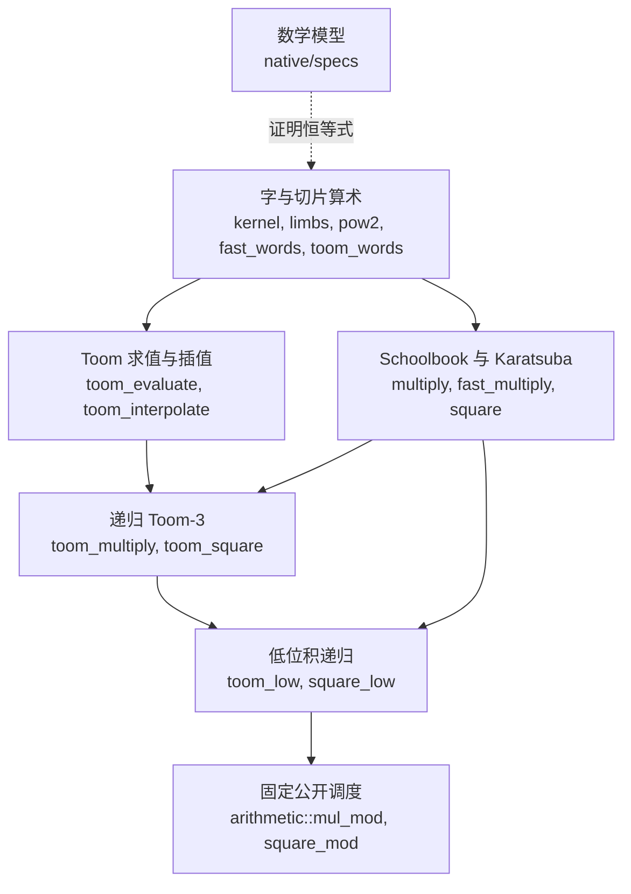

# VeriGMP

[English](README.md)

VeriGMP 是一个 Rust 多精度乘法、平方与模切片算术库，其可执行函数由
[Verus](https://github.com/verus-lang/verus) 证明正确。它借鉴 GMP（GNU Multiple
Precision Arithmetic Library，GNU 多精度算术库）的算法与存储策略，但实现和证明
均独立编写，并与 GMP 及本项目早先的代码做性能对照。

本库处于实验阶段，范围刻意保持狭窄：不验证 GMP 本身，不提供与 GMP 兼容的 API，
也不声称与 GMP 性能相当。

[packed convolution 数学模型](docs/packed-convolution.md) 为精确多项式算术提供
有限卷积、guard bits 与无进位提取定理，并连接连续 limb slot 的整数解释。
packing 和提取已有实验性的借用切片实现；同源功能 refinement 与运行时 oracle 已通过，
优化 release 构建对比确认 ghost 操作计数器未增加指令；独立验收和成本检查仍待完成。
多项式乘法和算术 dispatch 未改变。

已登记的性能目标是：主要负载的中位耗时不超过 GMP，全部关键尺寸不超过 GMP
的 1.2 倍。比较须采用相同结果语义、相同编译器工具链和相同源代码构建，并由第二次独立运行确认；当前尚未达到目标。
测量条件见 [性能契约](native/performance-target.json)，判定方法见
[基准说明](docs/benchmarks.md#performance-target)。

每个 optimization 可以独立验收并合入 main，无需等待整个 VeriGMP 达到 GMP target。
验收需要在声明的 workload 上相对当前 implementation 有可重复的 performance 收益，
并通过相关 regression、combination measurements、same-source proof、correctness checks、
independent Astra Max review。CI 是 supplemental evidence，不阻塞开发或 merge；
formal obligations 可按固定 source commit 分批验证，通过前准确保留 pending status。
收益取决于 input shape 时，dispatch 只覆盖有测量支持的范围。
替换 solver 的 trusted GMP backend 还需要通过全部 performance gates、第二次独立
confirmation、semantic compatibility 和 representative solver traces。
experiment archives 保存证据；archive 合入本身不代表 candidate 已启用。

## 计算什么

一个数表示为 limb 切片；limb 是一个 64 位字，切片按小端字序排列（低位 limb 在前）。记 `B = 2^64`，切片 `a`
表示 `value(a) = sum(a[i] * B^i)`。精度由 limb 数 `n` 和最高 limb 中的有效位数
`top`（1 到 64）共同描述，比特精度为 `p = 64*(n-1) + top`。

公开入口位于 `arithmetic` 模块：

| 函数 | 写入 `dst`（`n` 个 limb）的结果 | scratch 字数 |
|---|---|---|
| `mul_mod(dst, a, b, scratch, top)` | `value(a) * value(b) mod 2^p`，规范形式 | `workspace_len(n)` = `12n` |
| `square_mod(dst, a, scratch, top)` | `value(a)^2 mod 2^p`，规范形式 | `square_workspace_len(n)` = `10n` |

每个函数都带有陈述上述结果的 Verus 契约，Rust 函数体被证明满足该契约。输出和可
复用的 scratch 工作区由调用者持有，算术过程不分配内存。输入可以含有超出精度的高位，
`dst` 和 `scratch` 的初始内容无关紧要。

这两个函数背后是 schoolbook 乘法、差分形式 Karatsuba、五点 Toom-3、专用递归平方
以及截断低位积递归。少于 512 个 limb 的乘积走原有 Karatsuba 路径，更大的乘积走
Toom-3 路径。平方总是走专用低位平方递归：不超过 64 个 limb 时使用下述叶子内核；
超过时对 `n - floor(11n/36)` 个 limb 的低块做完整平方，该块超过 192 个 limb 用 Toom-3，
否则用 Karatsuba 平方。完整平方的叶子在至少 8 个 limb 时使用已证明的专用对称内核。
低位平方的叶子在 9 到 64 个 limb 时使用已证明的对称内核，只计算落在保留范围内的
交叉乘积，再将交叉项翻倍并加上对角项。完整平方在少于 8 个 limb 时、低位平方在
少于 9 个 limb 时保留通用乘法。
这些阈值是固定的、经测量选定的策略，并非最优性声明。

## 快速开始

固定版本的引导脚本支持 x86_64 Linux（含 WSL）。先安装 Python 3.12 或更高版本、
`g++`、`libgmp-dev` 和 rustup，然后运行：

```sh
git clone https://github.com/miles-song/VeriGMP.git
cd VeriGMP
rustup toolchain install 1.99.1 --profile minimal
python3 scripts/setup_verus.py
python3 scripts/verify.py
```

`setup_verus.py` 下载 [native/toolchain.json](native/toolchain.json) 中固定的 Verus
发行版，校验 SHA-256 后解压到 `deps/`。`verify.py` 证明并编译库，运行整数 oracle、
变异检查、代码生成检查和基准测试，并把编译产物 `build/libverigmp.rlib` 与对应的
Verus 元数据 `build/verigmp.vir` 一起导出，最后打印 `"status": "pass"`。

导出完成后，构建并运行示例：

```sh
VERUS_BIN="$PWD/deps/verus/verus-x86-linux/verus"
"$VERUS_BIN" examples/modular_arithmetic.rs \
  --import verigmp=build/verigmp.vir \
  --extern verigmp=build/libverigmp.rlib \
  --compile -O -o build/modular-example
./build/modular-example
```

[examples/modular_arithmetic.rs](examples/modular_arithmetic.rs) 的核心调用：

```rust
let n = a.len();
let mut scratch = vec![0u64; arithmetic::workspace_len(n).expect("n > 0")];
let mut out = vec![0u64; n];
arithmetic::mul_mod(&mut out, &a, &b, &mut scratch, top);
```

取 `a = [3, 1]`、`b = [5, 2]`，乘积模 `2^128` 为 `[15, 11]`，模 `2^65` 为 `[15, 1]`。
原生 Windows 及其他目标平台尚未用该引导流程验证。

## 模块如何组合



模型层定义字的含义并证明代数恒等式（例如五点 Toom 恒等式），不引用任何可执行输出。
其上的每一层证明自身 Rust 代码满足以这些术语陈述的契约，再上一层只依赖该契约。
[docs/architecture.md](docs/architecture.md)（英文）配有逐步示例。

## 状态与边界

[冻结的低位平方候选证据](docs/data/2026-11-02-low-square-cutoff9/metadata.json)
报告 234 个库验证项、0 个错误。11,292 个独立整数 oracle 用例中包含 1,440 个直接
低位平方用例，最大输入为 4,097 个 limb。当前 Toom／平方验收流程检查这些用例、
12 类无效输入和 21 个语义变异。完整 library proof claim 需要完整的 fixed-source
`verify.py` gate，isolated candidate report 不能建立该 claim。Incremental merge
由 local feature gates 与 independent review 决定，CI 为 supplemental evidence。验证项数量不等于公开函数数量，
详细范围与历史结果见 [docs/verification.md](docs/verification.md)。

证明覆盖的是功能 refinement：在所述前置条件下，输出具有所述整数值。终止性和
scratch 容量同样经过检查。在固定阈值下，Toom 递推给出 `O(n^log3(5))`（约
`O(n^1.465)`）次字运算的解析界；该界由人工推导，不是机器检查的代价定理。

单机实测见 [docs/benchmarks.md](docs/benchmarks.md)。与提交 `c083839` 相比，两轮
测试中 23 个 limb 的平方耗时减少 33–36%，64 个 limb 的平方耗时减少 45–47%；
9 到 64 个 limb 内采样的稠密尺寸在两轮中均有改善。这尚未达到 GMP 性能目标：
4,096 个 limb 时，两轮乘法耗时仍为 GMP 的 2.330、2.359 倍，平方为 2.173、2.141 倍。
链接的数据集保留了全部尺寸的结果，包括回退。

尚未实现：特定体系结构的汇编、更高阶 Toom 变体与 FFT、复合代价模型，以及通用除法、求逆或更高层的整数 API。确切的声明范围记录在 [native/proof-status.json](native/proof-status.json)。

## 文档

以下文档为英文：

- [docs/usage.md](docs/usage.md)：安装、API 契约、scratch 大小以及在其他项目中使用。
- [docs/architecture.md](docs/architecture.md)：表示、模块分层与算法。
- [docs/verification.md](docs/verification.md)：哪些被证明、哪些被测试、哪些被信任。
- [docs/benchmarks.md](docs/benchmarks.md)：测量方法与发布数据。
- [CONTRIBUTING.md](CONTRIBUTING.md)：如何修改一个模块而不削弱其证据。

## 许可与来源

VeriGMP 以 [MIT 许可证](LICENSE) 发布。启发算法的 GMP 6.3.0 源文件以哈希固定在
[native/gmp-reference.json](native/gmp-reference.json)。GMP 不链接进已验证库，只有
基准测试程序调用它。
