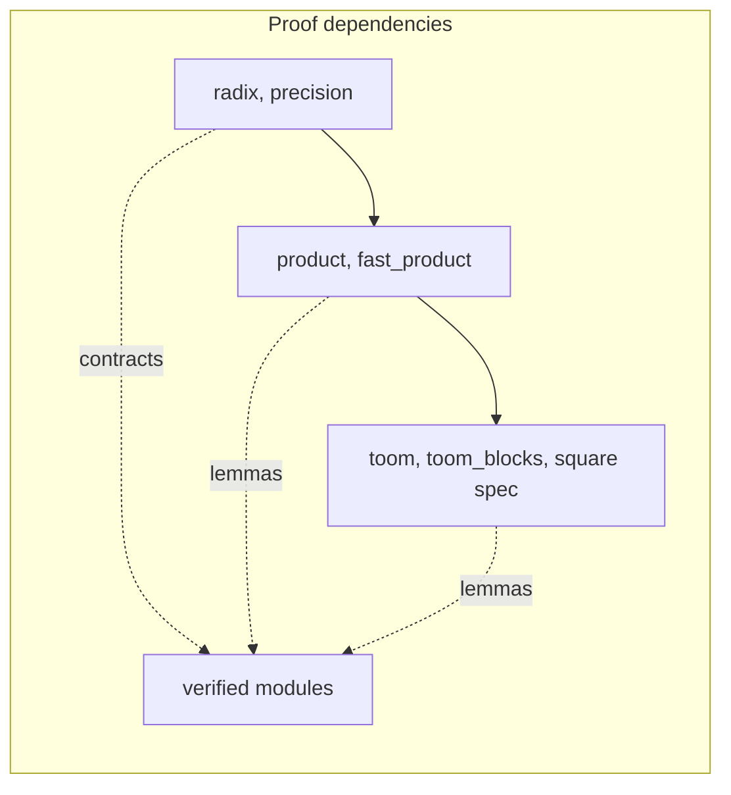
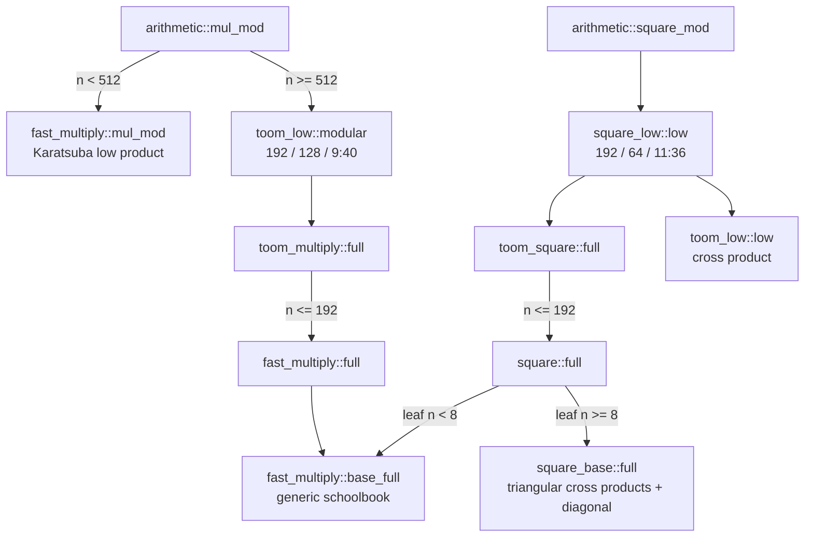

# Architecture

VeriGMP is organized so that each layer has one job and one contract. The bottom
layer states what words mean and proves algebra about integers. Each layer above
it implements an algorithm in Rust and proves that the algorithm meets a contract
written in those integer terms. The public functions sit at the top and only
choose among already-proved algorithms. This document explains the representation
first, then follows one small multiplication through the layers, and then
describes each algorithm and the module that owns it.

## Representation

A limb is one 64-bit unsigned word. A slice of `n` limbs is read little-endian:
with `B = 2^64`,

```text
value(a) = a[0] + a[1]*B + a[2]*B^2 + ... + a[n-1]*B^(n-1)
```

This definition is the Verus spec function `value` in
[native/specs/radix.rs](../native/specs/radix.rs). It maps a sequence of words to
an unbounded mathematical integer, so every contract can be stated as an equation
between integers rather than between word patterns.

Modular results use a bit precision `p = 64*(n-1) + top`, where `top` (1 to 64)
is the number of bits kept in the highest limb. The modulus `2^p` is the spec
function `modulus(n, top)` in [native/specs/precision.rs](../native/specs/precision.rs).
For `n = 2`, `top = 64` gives `2^128` and `top = 1` gives `2^65`. A result is
canonical when its value is below `2^p`; the functions that produce one clear the
unused high bits of the top limb.

## A small multiplication, step by step

Take `a = [3, 1]` and `b = [5, 2]`, so `value(a) = 3 + B` and `value(b) = 5 + 2B`.
Schoolbook multiplication adds one shifted row per limb of `a`:

```text
row for a[0] = 3:        3 * [5, 2]  = [15, 6, 0]
row for a[1] = 1:  B * ( 1 * [5, 2]) = [ 0, 5, 2]
sum                                  = [15, 11, 2]
```

The full product is `15 + 11B + 2B^2`. Modulo `2^128 = B^2` only `[15, 11]`
remains. Modulo `2^65`, the top limb keeps one bit, so `11` becomes `11 mod 2 = 1`
and the result is `[15, 1]`. These are the values checked by
[examples/modular_arithmetic.rs](../examples/modular_arithmetic.rs).

The words in this example are small, so no carries appear. Real limbs are full
64-bit values, and each word product can be up to 128 bits wide. For
`a = b = [B-1]`, the product is `(B-1)^2 = 1 + (B-2)*B`, which is `[1, B-2]`: the
low word is 1 and the high half of the 128-bit product becomes a carry into the
next limb. The scalar kernel computes this with a 128-bit multiply and returns
both halves. Its contract says that the low word plus `B` times the carry equals
the exact integer result. Every slice loop proves an invariant of the same shape:
after processing `i` limbs, the prefix written so far plus `B^i` times the pending
carry equals the exact partial sum. When the loop ends, the invariant becomes the
function's postcondition.

## Layers

| Layer | Files | Purpose and contract |
|---|---|---|
| Integer models | `specs/radix.rs`, `precision.rs`, `product.rs`, `fast_product.rs` | Define `value`, `radix(n) = B^n` and `modulus`; prove range, splitting, congruence, Karatsuba and low-product identities. |
| Polynomial models | `specs/toom.rs`, `toom_blocks.rs`, `square.rs` | Prove the five-point Toom-3 identities, three-block decomposition, coefficient bounds, product capacity and square symmetry. |
| Scalar words | `verified/kernel.rs` | Add-with-carry, subtract-with-borrow and word-level modular primitives. |
| Slice arithmetic | `verified/limbs.rs`, `pow2.rs`, `fast_words.rs` | Exact addition with carry out, subtraction with borrow, absolute differences, word scaling and precision normalization. |
| Toom words | `verified/toom_words.rs` | Padded add/subtract, exact scaling, exact division by a word, shifted modular accumulation. |
| Evaluation and interpolation | `verified/toom_evaluate.rs`, `toom_interpolate.rs` | Evaluate three blocks at 1, -1 and 2 (with a sign for -1); recover the middle coefficients from five point products in place. |
| Basecase and Karatsuba | `verified/multiply.rs`, `fast_multiply.rs`, `square.rs`, `square_base.rs` | Schoolbook rows, difference-form Karatsuba, low-product recursion, Karatsuba squaring and the triangular full-square leaf. |
| Toom recursion | `verified/toom_multiply.rs`, `toom_square.rs` | Full products and full squares with five recursive point products. |
| Low products | `verified/toom_low.rs`, `square_low.rs` | Products and squares modulo `B^n` built from one full block product and shorter low products. |
| Public dispatch | `verified/arithmetic.rs` | Fixed policy for `mul_mod` and `square_mod`, plus workspace sizing. |
| Candidate | `verified/mac4.rs` | Proved four-word row unrolling; measured but not used by default. |

All paths are relative to `native/`. [native/lib.rs](../native/lib.rs) declares
each file as a public module of the crate `verigmp`. Module names match file
names, for example `verigmp::arithmetic`. The square model/implementation pairs
use distinct names: `square_spec` / `square` and `square_base_spec` / `square_base`.

The model files contain only spec and proof functions, so they compile to nothing.
They are separate so that an identity such as "five point values determine the
product" is proved once about integers and cannot be shaped by what an
implementation happens to output.

## Two kinds of dependency

Proof dependencies and runtime calls follow different arrows. A proof dependency
means a contract or lemma is used to establish another. A runtime call means one
function executes another.



The runtime diagram below is a simplified module view of the default call graph.
It omits word helpers, evaluation, interpolation and some edges.



No verified function calls a model at run time, and no model refers to an
executable result. The code-generation inspection in
[verification.md](verification.md) walks the complete emitted call graph from
the two public entry points, including every helper this diagram omits.

## Karatsuba

Karatsuba splits each operand into a low block of `k` limbs and a high block, with
`R = B^k`: `a = a0 + a1*R` and `b = b0 + b1*R`. The product is

```text
a*b = a0*b0 + R*(a0*b1 + a1*b0) + R^2*(a1*b1)
a0*b1 + a1*b0 = a0*b0 + a1*b1 - (a0 - a1)*(b0 - b1)
```

so three half-size products replace four. The difference form computes
`|a0 - a1|` and `|b0 - b1|` with a sign bit for each, which avoids the extra carry
limb that `a0 + a1` would need. The absolute differences are written into the
output buffer before it is needed for the products, and the three recursive calls
reuse one child scratch region in sequence. Below a threshold the schoolbook
basecase takes over. The identity is `karatsuba_identity` in
`specs/fast_product.rs`.

## Toom-3 with five evaluations

Toom-3 splits each operand into three blocks of `k = ceil(n/3)` limbs (the top
block may be shorter). With `R = B^k`, the operand becomes the polynomial
`a(x) = a0 + a1*x + a2*x^2` evaluated at `x = R`, and the product `a(x)*b(x)` is a
degree-four polynomial `c0 + c1*x + c2*x^2 + c3*x^3 + c4*x^4`. Five values of that
polynomial determine its five coefficients. The points are 0, 1, -1, 2 and
infinity, where "infinity" means taking the leading coefficient:

| Point | Operand value | Product value |
|---|---|---|
| 0 | `a0` | `c0` |
| 1 | `a0 + a1 + a2` | `c0 + c1 + c2 + c3 + c4` |
| -1 | `a0 - a1 + a2` | `c0 - c1 + c2 - c3 + c4` |
| 2 | `a0 + 2*a1 + 4*a2` | `c0 + 2*c1 + 4*c2 + 8*c3 + 16*c4` |
| infinity | `a2` | `c4` |

Five recursive products of about `n/3` limbs replace nine. A small integer example
shows the whole cycle. Let `a(x) = 1 + 2x + 3x^2` and `b(x) = 4 + 5x + 6x^2`. The
point products are `4`, `6*15 = 90`, `2*5 = 10`, `17*38 = 646` and `3*6 = 18`.
Interpolation then runs the same steps as `toom_interpolate::interpolate`:

```text
(90 + 10) / 2          = 50   = c0 + c2 + c4
90 - 50                = 40   = c1 + c3
50 - 4 - 18            = 28   = c2
(646 - 4 - 16*18) / 2  = 177  = c1 + 2*c2 + 4*c3
(177 - 40 - 2*28) / 3  = 27   = c3
40 - 27                = 13   = c1
```

The coefficients are `[4, 13, 28, 27, 18]`, and `c(R)` recombines them by adding
each coefficient at offset `0, k, 2k, 3k, 4k` limbs. The divisions by 2 and 3 are
exact. Verus proves this before each division, so the code can use a quotient
without checking a remainder.

Three details carry the proof burden:

- Sign. `a0 - a1 + a2` can be negative. The evaluator stores its magnitude and a
  sign bit. The product's sign flag is the XOR of the two bits, and the signed
  magnitude it describes equals the exact value at -1; when the magnitude is
  zero the flag has no numerical effect. Interpolation adds or subtracts the
  magnitude according to the flag.
- Capacity. Each evaluation needs `k + 1` limbs, and each point product
  `2(k + 1)`. `product_capacity` in `specs/toom_blocks.rs` proves that 64 times the
  sum of the coefficients still fits in that width, so intermediate values cannot
  overflow their buffers.
- Ghost coefficients. The executable code passes the interpolator a ghost sequence
  `c` defined from the input blocks by the formulas in `specs/toom.rs`. The
  interpolator's precondition relates the five buffers to `c`, and its
  postcondition says the buffers now hold `c1`, `c2` and `c3`. The correct answer
  is never defined from the code's own output.

The point products and evaluations live in caller scratch:
five product regions of `2(k + 1)` words, one or two evaluation buffers of
`k + 1` words, and a remainder that is passed down to every recursive call in
turn. The proof checks that this layout fits the declared `12n` words for products
and `10n` for squares at every level.

## Low products

`mul_mod` needs only the low `n` limbs of a product. Splitting at `k = n - h`
limbs, with `h` the short block, gives

```text
a*b mod B^n = [a_lo*b_lo + B^k*(a_hi*b_lo' + a_lo'*b_hi)] mod B^n
```

where `a_lo`, `b_lo` are the low `k` limbs, `a_hi`, `b_hi` the top `h` limbs and
`a_lo'`, `b_lo'` the low `h` limbs. The first product is a full product of `k`
limbs. The two cross terms are themselves low products of `h` limbs, computed
recursively and added at offset `k`. The short block is `h = floor(9n/40)` for
Toom products, `floor(11n/36)` for the Karatsuba path and for squares, or `n/2`.
The identity is `low_identity` in `specs/fast_product.rs`.

## Squaring and symmetry

When both operands are the same, two kinds of work repeat.

In a five-point square, each point needs one evaluation rather than two, because
`a(x)` and `b(x)` are identical. The value at -1 squares to a nonnegative number
whatever its sign, so `toom_square` uses `signed_square` from `specs/square.rs`
and no sign bookkeeping reaches interpolation. Karatsuba squaring likewise
computes one absolute difference.

In a low square, the two cross terms `a_hi*a_lo'` and `a_lo'*a_hi` are equal.
`square_low` computes that low product once and adds it twice. A semantic
mutation test removes the second addition and is rejected by the proof.

For full-square leaves of at least eight limbs, the proved `square_base::full`
computes each cross product once, then combines twice the triangular sum with the
diagonal squares. Its independent model proves that this is the exact square.
The kernel performs `n(n-1)/2 + n` word multiplications, uses `O(1)` extra words,
and adds no scratch requirement. The operation count is an analytic count, not a
composed machine-checked cost theorem. Smaller full-square leaves use generic
multiplication. For the default low-square leaf, only a top-level input with
`25 <= n <= 64` enables symmetry specialization; smaller inputs and larger
inputs keep the original dispatch. For the specialized case, let `k = ceil(n/2)`
and `h = floor(n/2)`. The implementation squares the low `k` limbs with
`square_base::full`, computes the low `h` limbs of the high-by-low cross product
once, and adds it twice at offset `k`. The upper-block square is a multiple of
`B^n` and is omitted. This reuses the verified full-square and low-product
contracts, and the suffix congruence composes the two additions with
`low_identity`. The source-level word-multiplication count is
`k(k+1)/2 + h(h+1)/2`, versus `n(n+1)/2` for the generic low product. This is an
analytic count, not a composed cost theorem.

## Public dispatch

`arithmetic::mul_mod` uses the original Karatsuba low product for `n < 512`, and
`toom_low::modular` with Toom threshold 192, low threshold 128 and short ratio
9/40 otherwise. `arithmetic::square_mod` always uses `square_low::low` with Toom
threshold 192, low threshold 64 and ratio 11/36, then normalizes the top limb.
The low-square specialization is selected only for top-level `n` from 25 through
64 limbs; other lengths retain the original generic or recursive path. The
thresholds also act inside the recursion, and 192 limits the full low-block
square. At `n = 193`, for example, the short block is 58 limbs
and the 135-limb full block is still squared by Karatsuba. The original
`fast_multiply::mul_mod` API keeps its own Karatsuba policy and its `4n`
low-product workspace (`3n` for full products).

These thresholds are constants in the source, not run-time parameters, so the
compiler specializes the default call graph. They were chosen from local
measurements and are not claimed to be optimal for other machines. Forced
alternatives with other parameters exist in the modules and are exercised by the
oracle and benchmarks, but the public functions do not take tuning arguments.

Both entry points end by masking the top limb to `top` bits. The proof composes
"the low product is correct modulo `B^n`" with "masking is reduction modulo
`2^p`" using the fact that `2^p` divides `B^n`.

## Cost

For fixed thresholds, the Toom recursion performs two products of at most
`ceil(n/3)` limbs and three of `ceil(n/3) + 1` limbs plus linear work, which
solves to `O(n^log3(5))`, about `O(n^1.465)`, word operations. The low-product
recursion keeps the same order for all three splits. Scratch is linear in `n`,
and recursion depth is logarithmic. Verus checks scratch capacity and that every
recursive call receives a strictly smaller input; the operation-count bound
itself is derived by hand from the source recurrences and is not a
machine-checked theorem.
